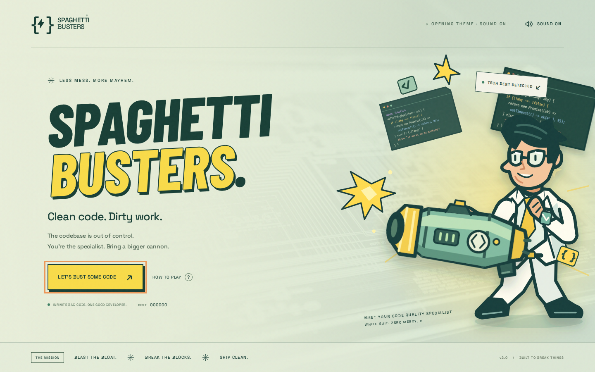
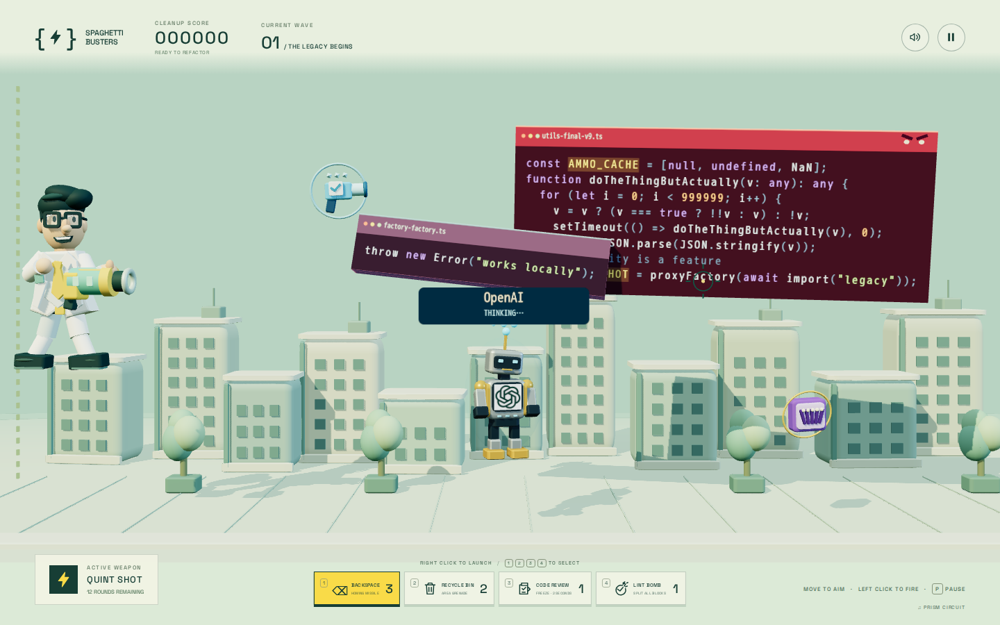
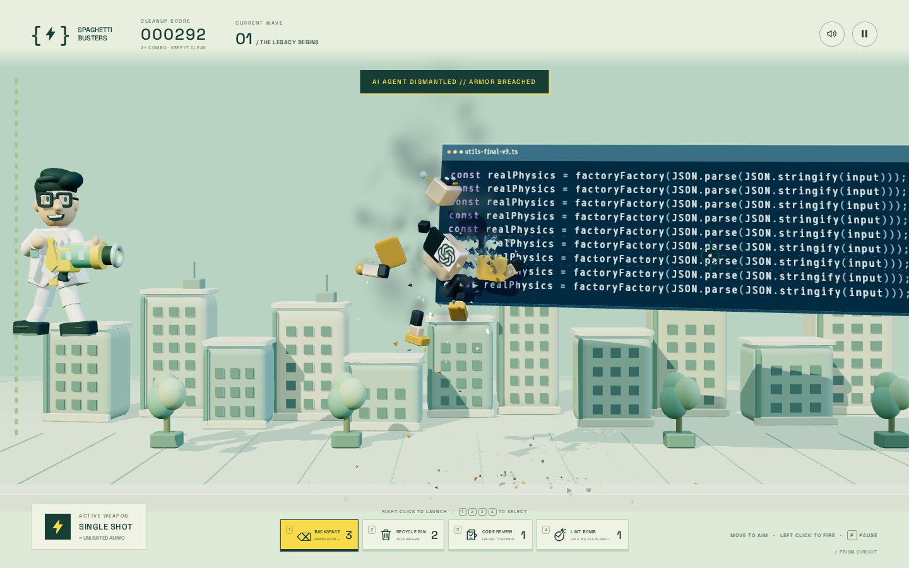
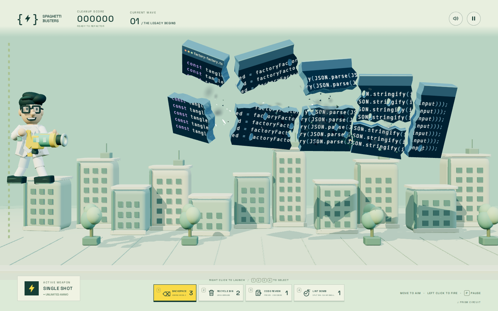
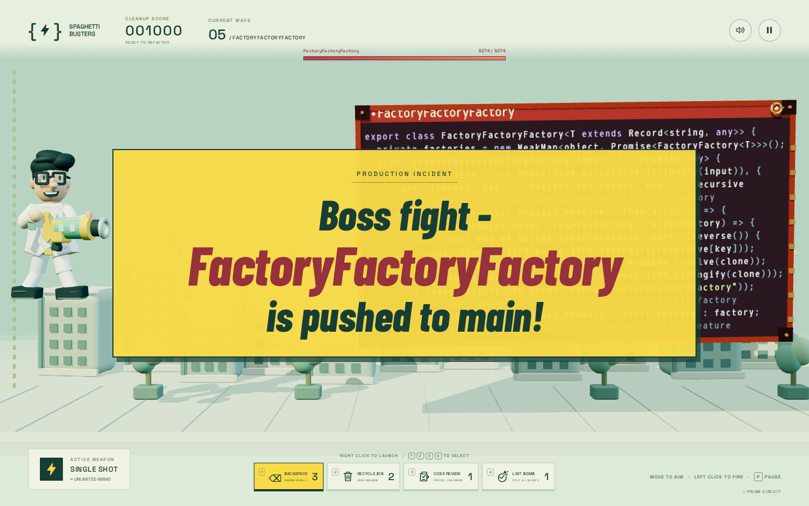

# Spaghetti Busters

**Clean code. Dirty work.** A fast arcade shooter about refactoring with a very large cannon.



Play as a bespectacled code quality specialist in a white suit. Blast huge, syntax-highlighted TypeScript blocks into flying letters and physics-driven fragments. Finish every chunk before it disappears through the left edge. Clear waves to take on faster, larger, tougher, and more numerous blocks from an expanded library of ridiculous code. The battlefield uses real Three.js WebGL rendering: solid code slabs tumble around all three axes, damage opens physical holes through their faces, and sculpted characters, weapons, and buildings share directional lighting and real shadows. Gameplay and collision physics remain on a 2D plane. Hits eject seeded 3D shrapnel, sparks, rising turbulent smoke, and actual syntax-colored letters. Rapier rigid bodies tumble, bounce, scrape, and settle on the pavement. Destroyed code slabs collapse into complementary jagged pieces of their original textured surface, with loose letters and collision-driven secondary chips and dust. Convex Rapier hulls make the chunks tumble, collide, and settle, retaining existing damage holes even after a screen-clearing blast. Destroyed robots break into their posed head, torso, arms, legs, and other real assemblies. Debris has no gameplay colliders. Fractures retain the parent slab’s surface, existing holes, and code coordinates, separated by complementary jagged cuts instead of repainting two new blocks.



## Play locally

Requires Node.js 22.13+ and npm. The pinned anti-slop Git dependency builds
with pnpm, so install pnpm before installing the project dependencies.

```sh
npm install --global pnpm@10.33.0
npm ci
npm run dev
```

Open **http://localhost:3000**. The server binds to all interfaces on port 3000.

## Deploy to Vercel

GitHub Actions deploys production after all CI checks pass on a push to `main`.
Follow the [Vercel setup guide](docs/vercel-deployment.md) to create a project and
configure the three GitHub secrets. No MCP connection is required.

## Controls

| Action                           | Control                                      |
| -------------------------------- | -------------------------------------------- |
| Move and aim                     | Mouse / drag on a touchscreen                |
| Primary fire                     | Left click, hold, or Space                   |
| Select homing backspace missiles | 1 or the Backspace slot                      |
| Select recycle-bin grenades      | 2 or the Recycle Bin slot                    |
| Select code review freeze gun    | 3 or the Code Review slot                    |
| Select lint bomb                 | 4 or the Lint Bomb slot                      |
| Launch selected special          | Right click / hold, or the touch FIRE button |
| Move vertically                  | Arrow Up/Down or W/S                         |
| Pause / resume                   | P, Escape, or the pause button               |
| Sound                            | Speaker button                               |

Landscape orientation gives touch devices the biggest battlefield.

Shoot highlighted `DOUBLE_SHOT` / `TRIPLE_SHOT` variables or the rarer `QUAD_SHOT` / `QUINT_SHOT` variables to release floating guns. **Shoot that weapon again** to equip it. Double/triple guns grant **30 / 24 rounds**; rare four/five-shot guns grant **16 / 12 rounds**. Repeated pickups of the same gun stack up to two magazines; `AMMO_CACHE` grants a small refill. The basic cannon always has unlimited shots. Backspace missiles continuously home on the code block closest to the left edge and detonate with a 180-pixel blast radius. Recycle-bin grenades arc toward your aim and clear a larger 300-pixel radius. Both blast through normal armor and damage every code block in range; boss armor takes multiple hits. Code Review freezes every enemy and its attacks for **2 seconds**, giving you time to keep firing. Lint Bomb splits **large visible blocks in half** and **destroys small blocks and exceptions** outright. Blocks with 160 or fewer living letters count as small, including chipped slabs and boss fragments. Each cast affects the original blocks once, so newly split halves survive until the next cast.

All four specials are available as shootable floating bonuses. Natural supply drops favor special ammo; hit `HOMING_MISSILE`, `RECYCLE_GRENADE`, `CODE_REVIEW`, or `LINT_BOMB` variables for more. Your best score is saved in your browser.

**Heavily armored AI robots** occasionally run in, stop in the middle to think, and generate enormous spaghetti code before leaving. Each takes **15 cannon hits** to destroy; missile and grenade blasts deal 4 and 5 damage. Destroying a robot stops its generation immediately. Its label shows remaining armor, and Code Review can freeze it. Each carries one of eight logos: OpenAI, Anthropic, Google, X, Moonshot, Z.ai, DeepSeek, or Meta.





**Angry code** is red, rattles, and regularly throws smaller `Error`, `TypeError`, `RangeError`, and rejected-promise blocks. Destroy or split the angry parent to stop its attacks, then clean up every exception too.

**Every fifth level is a boss fight.** `FactoryFactoryFactory` replaces the regular wave with a huge, heavily armored, slow-moving code factory that generates smaller blocks. Its health bar tracks all boss fragments, and splitting it does not multiply its production. Clear the factory and its remaining generated code to continue. Arrival flashes **“Boss fight - FactoryFactoryFactory is pushed to main!”** for one second with a spoken **“Boss fight”** cue.



Fast red `await setTimeout(milliseconds);` hazards target the specialist. Their enlarged, high-contrast labels make the timeout easier to read. Shoot them down or dodge vertically. A collision paralyzes movement, the primary cannon, and special weapons for the displayed duration. The battlefield keeps moving while you are frozen.

A single **Click to play** prelude unlocks browser audio; the opening screen then appears with a quiet melodic theme already playing. Starting a run smoothly blooms the same arrangement into gameplay. The soundtrack cycles through four original melodic compositions with different tempos, harmonies, and synth voices. Overlapping crossfades connect tracks; there is no persistent kick/snare beat. Music continues through menus and gameplay, and freezes while paused or muted.

## Build and verify

```sh
npm run format:check
npm run lint
npm run build
npm run preview
npm test
npx playwright install --with-deps chromium
npm run test:e2e
```

Run `npm run format` to apply Prettier to the project. Formatting uses Prettier's
standard defaults with LF line endings; generated output, the npm lockfile, and
vendored brand artwork are excluded.

Run `npm run lint` to check TypeScript, JavaScript, CSS, and duplicate code. The individual commands
are `npm run lint:eslint`, `npm run lint:oxlint`, `npm run lint:css`, and `npm run lint:duplicates`. ESLint
covers the supplied SonarJS, Unicorn, React, and stylistic rules; Oxlint runs the
supplied correctness, security, TypeScript, test, and
[anti-slop](https://github.com/sirknigget/anti-slop) rules with type information.
Duplicate detection uses jscpd; see [settings and manual calibration](docs/duplicate-detection.md).
Knip enforces unused code, exports, types, and packages in normal and production
runs. dependency-cruiser enforces import integrity, eager runtime cycles,
production dependency boundaries, source folder cycles, and architectural
boundaries between simulation, presentation, shared primitives, and audio. See the
[rule assessment and measured effects](docs/dependency-enforcement.md), including
discovery wiring, enforced architectural boundaries, and policies deliberately
left disabled.
Stylelint checks `src/**/*.css`. Source and colocated unit tests use separate
rule scopes, and the lint TypeScript project also includes browser tests and
root configuration files and lint policy modules. All JavaScript and TypeScript,
including tests and configuration, are limited to **300 physical lines per file**,
**40 physical lines per function**, **3 declared parameters per function/method**,
and **30 directly declared members per class, interface, or object type**.
Line counts include comments and blank lines. Member counts include both fields
and methods; inherited members are not combined. TypeScript method, call, and
construct signatures share the parameter limit. Oxlint enforces a maximum
cognitive complexity of **8** and cyclomatic complexity of **6** using anti-slop.
Union-alternative counts remain unlimited.

The custom Oxlint `project/folder-limits` rule checks `src` and `tests`, including
both roots and every nested folder. Each folder may contain at most **10 direct
files** and **10 direct subfolders**. Files of every type count, including tests,
JSON, assets, and hidden files; a child's contents count only against that child.
The rule scans the complete trees once per lint invocation, including folders
without JavaScript or TypeScript. Symlinks count as files and are not traversed.
Diagnostics name the offending folder and appear on the first linted file.

Oxlint’s built-in `no-restricted-imports` rule applies to all linted JavaScript
and TypeScript, including configuration and lint modules. Local imports use
`#root/...` with explicit extensions, resolved from the project root by the
`package.json` imports map. Package and Node built-in imports remain unchanged;
browser-evaluated test imports use `/src/...` or `/tests/...` URLs. Relative
imports and re-exports are errors, including dynamic imports, `require`, and
TypeScript import forms. ESLint’s built-in `no-restricted-syntax` covers
`require`, import-type expressions, and computed paths that Oxlint does not
inspect. Computed specifiers are rejected so paths can be checked statically.
Both linters run in their existing parallel CI jobs.

Readability rules require braces for control flow, one statement per line,
separate variable declarations, and blank lines after blocks, before returns,
and between methods. Declaration groups (`const`, `let`, and `var`) must be
separated from other statements by a blank line. Consecutive declarations may
stay together unless a declaration ends in a block. Prettier retains its
80-column layout. Run ESLint with `--fix` followed
by `npm run format` to apply spacing fixes. These rules discourage compressing
statements to evade the size limits.

Runtime numeric literals, including defaults, class fields, object properties,
and assignments, must use named scalar constants or declarative JSON tuning.
Only `0`, `1`, and `-1` are allowed inline; numeric enum members and literal types
remain semantic declarations. Existing browser and unit test fixtures retain
their numeric exemption. ESLint enforces this source policy.
Authored 3D geometry stays in glTF/GLB assets; the authored 2D crack paths use SVG.

Literal colors belong in `src/game/palette.ts` or CSS custom-property definitions
in `src/palette.css`. Built-in ESLint restrictions reject hex and CSS color-function strings.
Built-in Stylelint rules reject hex colors, named colors, and color functions
outside the CSS palette. Existing CI lint jobs enforce both policies.

The anti-slop dependency is pinned to an immutable Git commit.

GitHub CI checks formatting, ESLint, Oxlint, Stylelint, unit tests, the production
build, unused code in normal and production modes, dependency integrity, and
browser tests on pull requests and pushes to `main`. Checks run as
independent parallel jobs, with browser tests split across two runners and one
browser worker per runner.

`preview` serves the production build on port 3000; stop the development server first. Browser tests reuse a running development server or start one automatically. They run one browser at a time to keep software WebGL rendering responsive in CI. On headless Linux without a GPU, Mesa/EGL libraries (`libegl1`, `libegl-mesa0`, and `mesa-vulkan-drivers`) provide the real WebGL 2 context used by the tests.

The deterministic simulation tests cover damage, splitting, impulses and bounces, difficulty progression, two-stage pickups, scarce ammunition, homing and area weapons, timeout collisions, stun and recovery, loss conditions, and reset. Playwright exercises the actual rendered game, separate left/right fire, number-key selection, touch special controls, paralysis and recovery, pause/resume, help, sound controls, restart, score persistence, real mesh depth and rotation, physical damage holes, original-surface code disintegration and settling after cannon/explosive/lint kills, GPU-resource disposal, graphics context recovery, robot armor/destruction/generation, angry exception attacks, four-special controls, fifth-wave boss progression, shared factory generation, boss armor/health, the one-second headline, and bundled voice playback.

## Project

- `src/game/simulation/`: renderer-independent gameplay facade, grouped world/player/progress state, and focused collision/wave/weapon systems with small fixed substeps.
- `src/game/scene/`: native pointer/keyboard input, frame loop, and simulation-to-renderer adapter.
- `src/game/graphics/` and `src/game/content/`: shared model/glyph/resource primitives and authored code samples, independent of world orchestration.
- `src/game/rendering/` and `src/game/code/`: Three.js scene, perspective camera, glTF model loading, perforated code geometry, shadows, and GPU resource cleanup.
- `src/game/debris/` and `src/game/geometry/`: independent Rapier debris, pooled smoke/sparks, compact perforated surfaces, and direct triangle clipping for final disintegration.
- `src/game/audio/`: Web Audio routing, synthesis, effect scores, and music transport; opening theme, seamless menu/game transitions, and four crossfading scores.
- `src/main.ts` and `src/style.css`: responsive menus, HUD, dialogs, and accessibility.
- `public/assets`: original cartoon SVG artwork and a locally bundled opening-screen photograph.
- `public/assets/models/arcade-models.glb`: editable glTF 2.0 library for the specialist, robots, weapons, city, effects, armor, and debris. [Model editing and validation](docs/models/README.md).

The Three.js renderer loads when the player starts. A browser supporting WebGL 2 is required. Graphics context loss pauses play and allows resuming after restoration. All game assets and fonts are bundled locally, so gameplay has no external service dependency. Development builds expose `window.__spaghetti` for deterministic browser tests; production builds do not.

## Credits

Robot brand marks are bundled from [Lobe Icons](https://github.com/lobehub/lobe-icons) (MIT) and [Simple Icons](https://github.com/simple-icons/simple-icons) (CC0). Source details and the license are in `public/assets/brands/`.

The bundled robotic “Boss fight” voice was generated with [eSpeak NG](https://github.com/espeak-ng/espeak-ng); no speech service or runtime voice dependency is required. Cartoon artwork, original chiptune music, and sound effects were created for this game. The opening backdrop is [a technology photograph from Unsplash](https://images.unsplash.com/photo-1550751827-4bd374c3f58b), used under the [Unsplash license](https://unsplash.com/license). Barlow Condensed and Space Grotesk are bundled under their SIL Open Font Licenses in `public/fonts/`.
